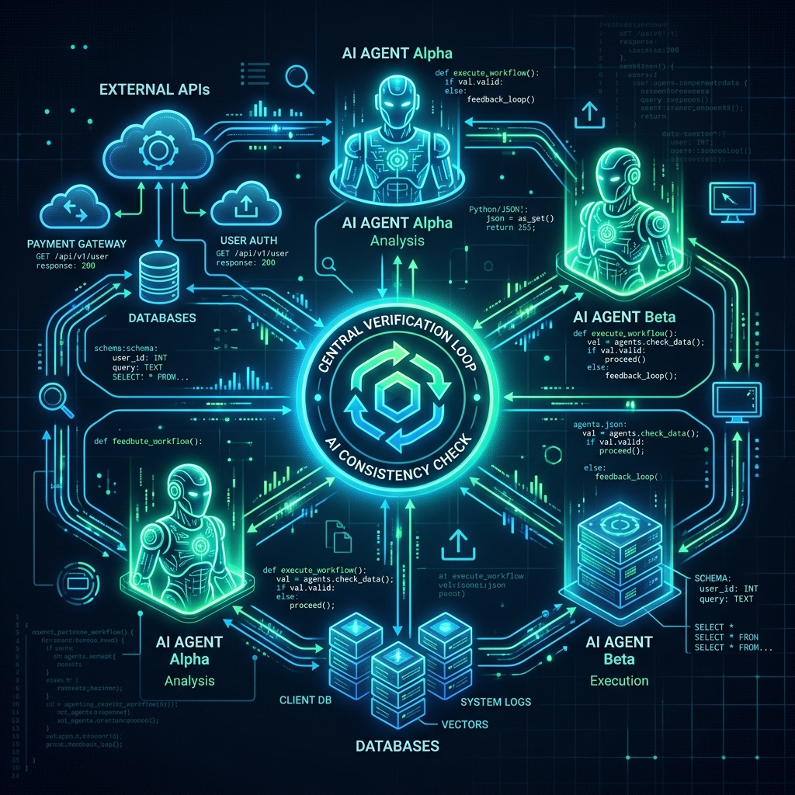

The previous article introduced spec-driven development as a way to collaborate with AI agents. Writing small functions or helpers is only the beginning: the next question is how an agent fits into the surrounding development workflow.

This article explores automation, external context and verification as parts of that workflow.



## 1. Agent Hooks: automating repetitive work

Have you ever saved code and later noticed missing documentation or formatting? Hooks connect development events to follow-up tasks, reducing how often you have to remember a separate prompt.

For example, creating a component could trigger a request to inspect its props and suggest documentation. The intended workflow is:

1. Detect a relevant file event.
2. Limit the trigger to the intended component paths.
3. Ask the agent to inspect the new code.
4. Review the resulting documentation change.

Configuration should match the hook format supported by the installed version. Keep automated edits reviewable and avoid triggers that repeatedly rewrite their own output.

## 2. Model Context Protocol (MCP)

An AI agent working only from repository files may lack the context needed to understand a database schema, an internal API or an external operational system.

**Model Context Protocol (MCP)** provides an interface between AI applications and tools or data sources. Possible integrations include:

- **Databases:** inspect schema information when working on SQL queries.
- **External APIs:** retrieve the relevant documentation for an integration.
- **Project tools:** run an approved validation command before considering a task complete.

The useful distinction is between context the agent can read and actions it can perform. Scope access to the task and review operations that affect external systems.

## 3. The verification loop

Generated code can look convincing and still fail at boundaries. A verification workflow connects the intended behavior to examples that challenge the implementation.

After a function is written:

1. **Read the specification:** identify its contract, such as returning a positive integer.
2. **Test boundaries:** include empty values, nulls, unusually long strings and negative numbers where relevant.
3. **Inspect failures:** understand the cause, revise the change and rerun the checks.

The goal is stronger evidence about behavior. Passing tests should be interpreted in terms of what those tests actually cover.

## 4. Agents in CI/CD

A command-line agent can also be considered as part of a CI workflow. One possible design starts with a failed test, asks an agent to investigate in an isolated branch and produces a proposed pull request for review.

```text
Failing test
  → isolated investigation
  → proposed code change
  → validation
  → pull request for human review
```

Treat this as a workflow design. The commands, authentication and permissions need to match the installed tooling and repository policy. Keep the agent's proposed change separate from the decision to merge or deploy it.

## Putting the pieces together

Specifications describe the intended change, hooks reduce repetitive prompting, external tools add context and verification checks the resulting behavior. The value comes from connecting those pieces into a workflow that remains understandable and reviewable.

Start with a bounded task, inspect the diff and record which checks were run before expanding the level of automation.
